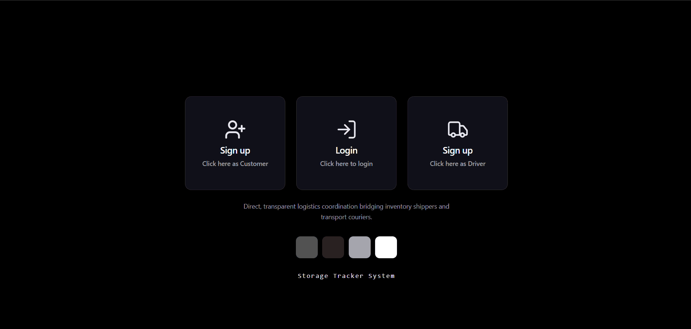
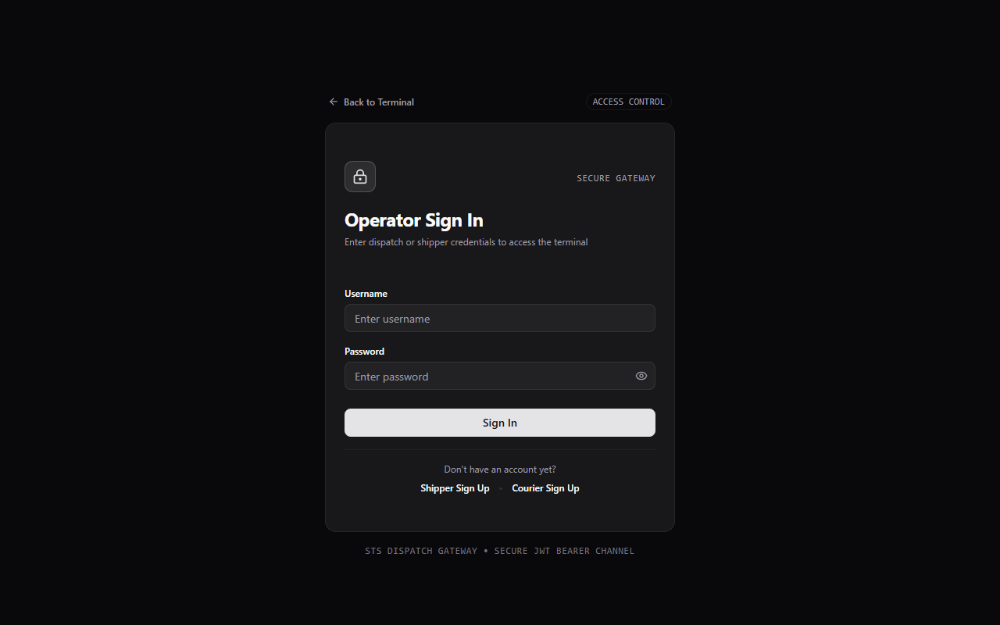
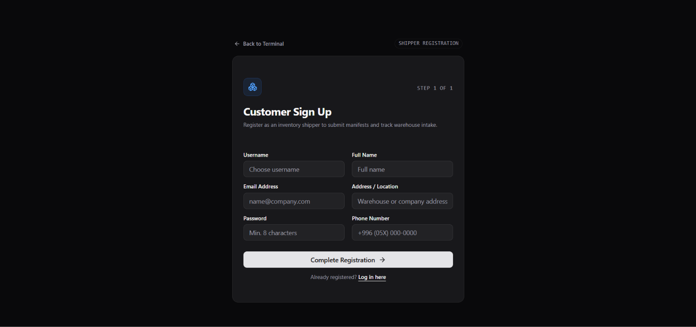
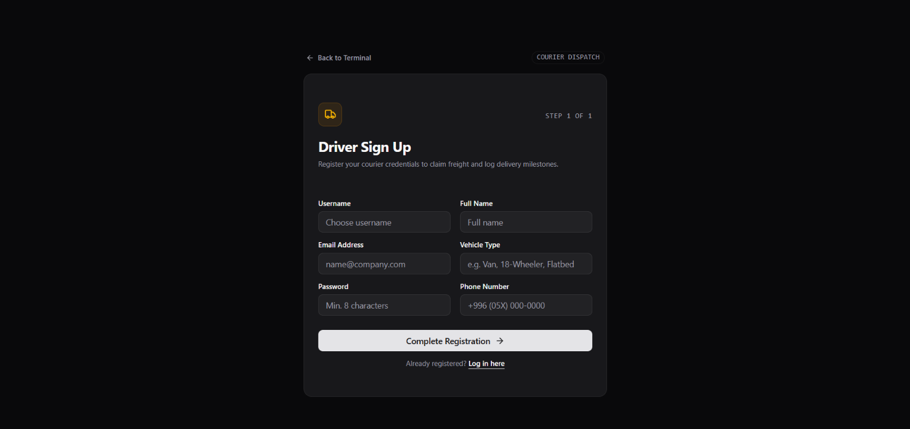
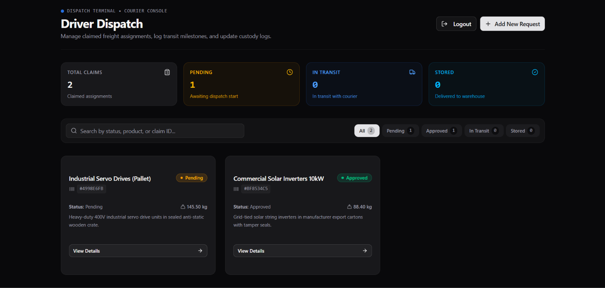
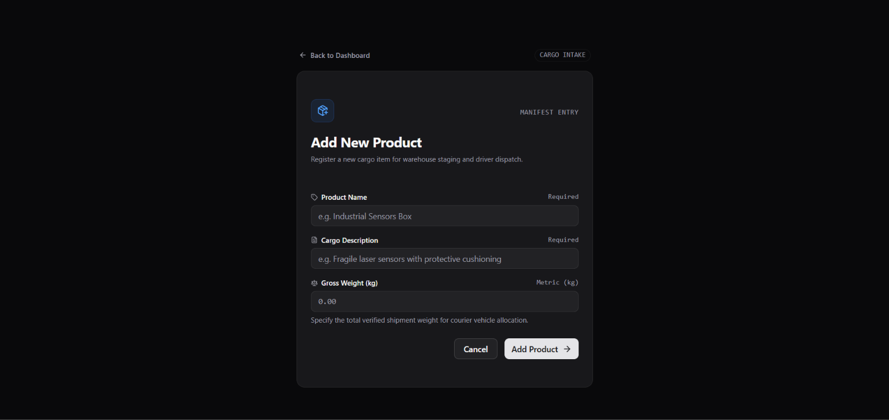
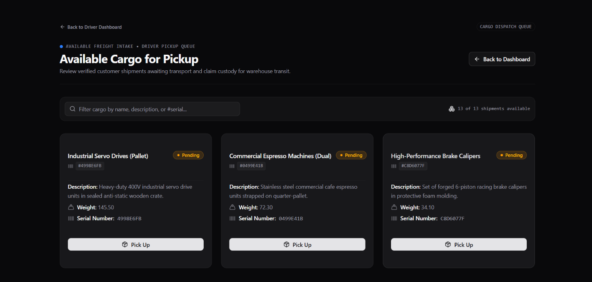

# Frontend - Storage Tracker System (STS)

This is the frontend application of the **Storage Tracker System (STS)**. It provides a modern, high-density logistics tracking portal for both **customers** (inventory shippers) and **drivers** (couriers) to coordinate freight storage and dispatch. Customers can sign up, log in, and manage their product shipments with live status telemetry, while drivers can claim pending cargo, execute pickups with confirmation workflows, and update warehouse delivery milestones. This application is built with **React 19**, styled using **Tailwind CSS v4** and official **shadcn/ui** components, and communicates with a Django REST API backend.

---

## Tech Stack

The frontend application was developed using the following technologies:

- **React 19**
- **React Router DOM 7**
- **Tailwind CSS v4**
- **shadcn/ui & Radix UI Primitives**
- **Lucide React**
- **Axios**
- **Vite**
- **Puppeteer** (Automated E2E Testing)
- **Dotenv**
- **ESLint** 

---

### Backend Repository

> [https://github.com/AyDossari/backend-STS](https://github.com/AyDossari/backend-STS)

---

## Installation Instructions

To run the frontend application locally:

1. Clone the repository:
   ```bash
   git clone https://github.com/AyDossari/Frontend-STS.git
   cd <project-directory>
   ```

2. Install the dependencies:
   ```bash
   npm install
   ```

3. Start the development server:
   ```bash
   npm run dev
   ```

Make sure the backend server is running on the same port as specified in your `.env` file.

---

## Testing & Quality Assurance

The application uses automated End-to-End (E2E) testing with **Puppeteer** (following **ISO/IEC/IEEE 29119** standards) to simulate realistic user workflows and edge cases:

```bash
# Run the automated E2E simulation suite
npm run test:e2e
```

**Key Verified Flows:**
- **Validation & Auth:** Login rejection, duplicate username detection, and password strength checks.
- **Customer Journey:** Manifest creation, real-time status tracking, updates, and deletion.
- **Driver Dispatch:** Freight claiming, delivery status updates, and handovers.

---

## Screenshots

Below are key screens from the frontend application showing the flow for both customers and drivers:

### 1. **Home Page** – Landing screen with options for login/signup  
   
  
### 2. **Login Page** – Operator authentication gateway for shippers and courier drivers  
   

### 3. **Sign up Pages** – Dedicated registration portals tailored for shippers and logistics couriers

#### 3.1 **Sign up as Customer** – Onboarding form for inventory owners to submit cargo manifests and warehouse storage requests  
   

#### 3.2 **Sign up as Driver** – Courier onboarding form capturing driver credentials, contact info, and vehicle specifications  
   


### 4. **Operational Dashboards** – Role-based command consoles providing real-time cargo telemetry and dispatch feeds

#### 4.1 **Customer Dashboard** – Central tracking console with live shipment metrics (Pending, In Transit, Stored), search filters, and inventory actions  
   

#### 4.2 **Driver Dashboard** – Courier dispatch terminal displaying claimed freight assignments, transit milestones, and delivery logs  
   

### 5. **Add Product** – Form for customers to create a new product  
   

### 6. **Create Request (Driver)** – Interface for the driver to pick up a product  
   

---

## IceBox Features

Planned capabilities for future iterations:

- Real-time WebSocket notifications for instant driver pickup and custody handover alerts
- Interactive map integration for route optimization and GPS tracking of cargo in transit
- In-browser barcode / QR code scanning for fast physical warehouse intake verification
- Automated PDF manifest export and printable freight waybills

---

## Key Achievements & Engineering Wins

- **Full-Stack Logistics Architecture:** Implemented role-isolated customer and courier workflows protected by JWT authentication and Django backend RBAC.
- **Design System Craft:** Transitioned from legacy layout styles to "The Freight Terminal"—a responsive, accessible interface built with shadcn/ui and Tailwind CSS v4 adhering to strict 4px grid rhythm.
- **Automated Verification:** Designed and maintained a 23-scenario End-to-End (E2E) browser simulation suite using Puppeteer under ISO/IEC/IEEE 29119 testing standards.
- **Zero-Overflow Responsive Layouts:** Optimized all data-entry forms, confirmation dialogs, and telemetry dashboards for flawless performance down to 320px mobile viewports.
